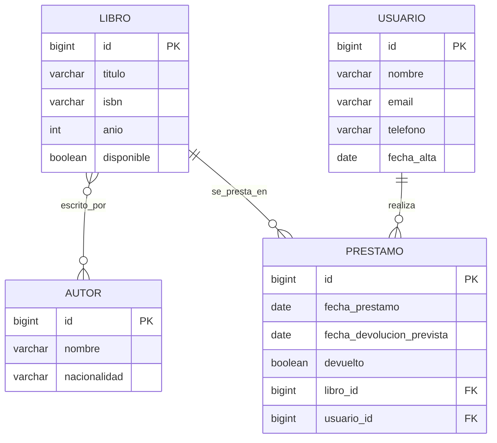

# Producto 2 · Diagrama E/R (Biblioteca)

Entidades: **Libro**, **Autor**, **Usuario**, **Préstamo**.

| Relación | Cardinalidad | Descripción |
|---|---|---|
| Libro – Autor | **N:M** | Un libro puede tener varios autores y un autor varios libros. Se implementa con la tabla intermedia `libro_autor`. |
| Usuario – Préstamo | 1:N | Un usuario puede tener muchos préstamos; cada préstamo pertenece a un usuario. |
| Libro – Préstamo | 1:N | Un libro puede prestarse muchas veces; cada préstamo corresponde a un libro. |

