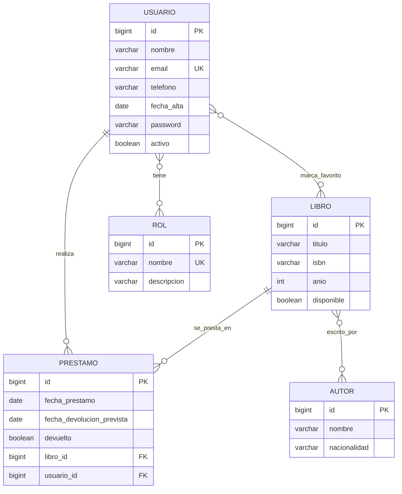

# Diagrama E/R (Biblioteca) · actualizado en el Producto 3

Entidades: **Libro**, **Autor**, **Usuario**, **Préstamo** (Producto 2) + **Rol** (Producto 3).

| Relación | Cardinalidad | Descripción | Desde |
|---|---|---|---|
| Libro – Autor | **N:M** | Un libro puede tener varios autores y un autor varios libros. Tabla intermedia `libro_autor`. | P2 |
| Usuario – Préstamo | 1:N | Un usuario puede tener muchos préstamos; cada préstamo pertenece a un usuario. | P2 |
| Libro – Préstamo | 1:N | Un libro puede prestarse muchas veces; cada préstamo corresponde a un libro. | P2 |
| **Usuario – Rol** | **N:M** | Un usuario puede tener varios roles (ADMIN, USER) y un rol lo tienen muchos usuarios. Tabla `usuario_rol`. Es la parte de **seguridad**. | **P3** |
| **Usuario – Libro (favoritos)** | **N:M** | Un socio marca libros como favoritos; un libro puede ser favorito de muchos socios. Tabla `usuario_favorito`. Es la nueva relación de **lógica de negocio** con una entidad anterior. | **P3** |

Cambios en **Usuario** (P3): se añaden `password` (cifrada con BCrypt) y `activo`. Queda con 7 atributos: id, nombre, email, telefono, fecha_alta, password, activo. El `email` es el nombre de usuario para iniciar sesión.

